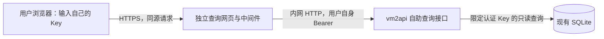

# vm2api Key 用量查询中间件与网页设计

状态：方案草案，等待用户评审；尚未实现或部署。

## 已确认的需求

- 查询对象是 **vm2api 创建的 Key**，不包含 new-api 下游 Key。
- 用户持有自己的 Key，可以查询指定时间范围内的使用量。
- 用户已选择 **独立中间件＋网页**。
- 本轮交付设计方案。下面标为“建议”的范围、容量和保留期是设计默认值，尚不是用户确认的运营规则。

## 现有能力与实现选择

现有 `GET /v1/me/usage` 支持今天、近 7 天、近 30 天的统计及分页明细，`GET /v1/me/quota` 支持自身额度。身份来自已认证的 managed key，查询 SQL 限定 `api_key_id`。接口不发模型请求、不占推理并发、不扣模型额度；额度耗尽或到期的 Key 仍可查询，停用、删除或属主停用的 Key 应拒绝。

当前接口不支持任意起止时间；汇总没有披露日志裁剪或未定价的完整性，不能直接作为本需求的最终接口。明细日志默认保留 7 天，可配置 1–90 天。已被删除的数据无法从 Key 累计计数中还原出每日或任意时间段分布。

| 方案 | 取舍 | 决定 |
| --- | --- | --- |
| 独立中间件＋网页，通过受限自助接口读取 vm2api | 独立镜像和发布；需要维护一项小服务以及 vm2api 的查询接口扩展 | 用户已选择 |
| 直接在 vm2api 内增加查询页 | 少一个 Deployment，但查询页面随主服务一起发布 | 未选择 |

独立中间件通过内网 API 获取数据；数据库仍由 vm2api 访问。中间件不挂载 SQLite PVC、不持有管理员 Key，也不维护第二份用量数据库。



## 用户如何使用

1. 打开专用查询网页，输入自己的 Key；输入框默认遮挡，可临时显示。
2. 选择“今天、昨天、近 7 天、近 30 天”或自定义起止日期/时间。
3. 查看请求总数、成功/失败数、输入/输出/缓存 Token、区间统计费用。
4. 查看按小时/天的趋势、按模型的分布，以及分页请求明细。
5. 点击“清除 Key”移除页面中的 Key 和查询结果。刷新页面后需重新输入。

建议第一版采用单页，桌面和手机均可操作。第一版不增加注册、充值、Key 管理、多 Key 合并、CSV 导出或对话内容展示。网页与其查询 API 同域部署。

Key 状态和剩余额度作为辅助信息展示；“区间费用”与“额度已使用”分开呈现，因为管理员重置额度会影响后者。

## 统计口径

| 指标 | 定义 |
| --- | --- |
| 请求总数 | 指定 Key 在区间内的 `usage_logs` 记录数，包含已记录的失败请求 |
| 成功 / 失败 / 其他 | 按统一客户端结果分类；中断、结果尚未确定的记录单列，不硬算成功 |
| 输入 Token | 已规范化的非缓存输入 `input_tokens` |
| 输出 Token | `output_tokens` |
| 缓存 Token | 分开展示读取与写入；总 Token 不重复计算缓存输入 |
| 区间费用 | 该区间日志当前已记录的 `actual_cost` 合计，USD；历史补价/修正可能改变该值，属于当前日志统计费用，不承诺等于不可变的历史扣费账单 |
| 未定价请求 | 单独计数；有未知费用时标明“已知费用”，不能把未知金额显示为免费 |
| 模型 | 客户端看到的模型名；缺失时显示“未知”，不回退显示内部上游映射名 |
| 请求明细 | 时间、请求 ID、模型、结果、Token、费用、耗时；不含提示词、回答、上游账号、节点、代理或 IP |

时间默认 `Asia/Shanghai`，数据库时间统一 UTC。日期选择器的结束日期包含整日，转换为下一日零点；服务端统一使用 `[start, end)`，避免跨日重复计数。单次区间建议最多 90 天，未来结束时间截止到服务端当前时间；查询按请求的 `created_at` 归属，进行中的请求及稍后更新的统计可能在刷新后变化。

区间统计必须查日志，不能用两个时刻的 `api_keys.quota_used` 相减。Key 累计信息只作独立额度说明，不用于回填已缺失的历史。页面费用说明明确提示“按当前日志价格记录统计，历史补价或修正可能调整金额”；不在第一版建立独立扣费账本，也不宣称日志统计金额必然与曾经扣减的额度完全相等。

## 数据保留与完整性

建议从功能启用起将 **请求用量摘要保留 90 天**，调试内容继续按单独的短周期清理。该建议不代表保留提示词/回答 90 天，也不会恢复此前已经清理的日志。

每次响应携带查询范围、实际统计截止时间和覆盖说明：

- `available_from`：数据库创建与已记录的日志裁剪边界推导出的可用起点。
- `coverage_status`：`partial`、`unknown` 或 `complete`；只有存在足够记录证明期间持续采集时才能承诺 complete。
- `missing_before` / `reason`：请求区间早于保留边界时标明缺失；历史关闭日志等情况无法证明时标记 unknown。
- `unpriced_requests`：费用尚不完整的记录数。

第一版复用现有裁剪边界，明确说明它只能证明保留范围，不能证明旧历史从未停过日志。因此缺少采集连续性证据时显示“按当前保留日志统计”。已知缺失不冒充完整查询；空结果和数据缺失分别展示。

## 接口约定

独立服务对浏览器提供：

```http
GET /api/usage?start=2026-11-01T00%3A00%3A00%2B08%3A00&end=2026-11-11T00%3A00%3A00%2B08%3A00&tz=Asia%2FShanghai&bucket=day&limit=20
Authorization: Bearer <用户自己的 Key>
```

返回 `range`、`as_of`、`coverage`、`summary`、`series`、`models`、`recent`，分页使用 `next_cursor`。明细每页默认 20、上限 100，所有汇总、图表、模型和明细严格使用同一 Key、同一时间范围。`bucket` 仅允许 hour/day；小时图限制最多 7 天，较长区间使用天。模型列表明确返回截断标记/其他汇总，不能静默遗漏总体中的模型。

`GET /api/quota` 只返回 Key 名称/掩码、状态、到期时间和该 Key 自身额度。剔除现有 quota 输出中的 `user_concurrency`，它包含同一属主的其他 Key 信息。

在 vm2api 新增 `GET /v1/me/usage/range`，复用自助 Key 认证和只读查询 worker；保留现有 `/v1/me/usage` 的响应兼容性。同一个仓库方法完成区间查询，在同一 worker 的只读连接/短事务中获得一致结果。**新区间接口禁止同步回退到主线程的 DatabaseSync 查询**；无可用 worker/容量时返回 503 和可重试提示。执行截止必须由查询中断或终止并重建执行 worker 实现，不能只让 HTTP 请求超时而留下一条无期限查询。对 vm2api 直连此接口的请求同样生效，中间件的限制不能替代网关内限制。

服务端严格校验带时区的时间、顺序、跨度、分页和 bucket。不接受客户端提供的 `key_id`、SQL、上游地址或转发路径。Key ID 只能来自认证结果；SQL 使用绑定参数，已有 `(api_key_id, created_at)` 索引优先复用，是否扩展索引由真实查询计划决定。

分页游标只能继续相同过滤条件，后端必须再次鉴权并强制当前 Key 约束。页面保留查询时的截止时间来翻页；切换 Key 或时间范围立即清除旧结果/游标并取消旧请求，防止较慢的旧请求覆盖新页面。

## Key 与权限隔离

- 浏览器只在当前页面内存保存 Key，不写 URL、Cookie、localStorage、sessionStorage 或分析埋点。
- 中间件仅为当前请求转发 Bearer，固定目标为 `http://vm2api.vm2api.svc.cluster.local:8787`，仅允许上述自助路径；不透传 Cookie、面板令牌或任意用户头，不跟随重定向到其他主机。
- vm2api 负责权威认证；中间件不维护 Key/用户副本，也不需要管理权限。查询采用“持有该 Key 即可查看该 Key 用量”的权限模型。
- 到期/额度耗尽仍可查询；停用、删除或属主停用拒绝；主密钥和面板会话不能作为查询凭据。
- 核对并统一旧版 Key 首次迁移认证的属主状态校验，避免 legacy 分支绕过属主停用检查。
- 所有层的访问日志、错误日志、追踪字段统一去除 Authorization、x-api-key 和输入内容；错误响应不能回显 Key 或内部上游响应。
- 认证结果与用量响应 `Cache-Control: no-store`；不使用 CDN 缓存、Service Worker 缓存或共享查询缓存。
- 同源页面、严格 CSP、无第三方脚本；查询失败/超时不显示之前 Key 的缓存内容。
- 入口 IP 限流与鉴权后的 Key 限流分开；建议每 Key 20 次/分钟，每 IP 60 次/分钟，允许配置以适应共享出口。单副本先使用有容量上限的内存限流表，Key 标识使用内部 ID 或不可逆指纹。
- 查询不调用模型，不扣模型额度、不占推理槽位。健康检查不依赖任何真实 Key。

## 部署建议

- 一个新 Deployment：`vm2api-usage`，中间件同时提供构建后的网页静态资源。
- Node.js 22 后端、独立 React/Vite 页面，复用仓库熟悉的技术和锁文件策略；在 `services/key-usage-portal/` 隔离开发，独立 Dockerfile。
- 首版单副本，无业务数据库、无 Redis、无 PVC；建议 requests 为 100m CPU / 128Mi 内存，limits 为 500m / 256Mi，最终以构建后压测和内存观察调整。
- 继续限制在 `nodetype=new-api` 且 hostname 属于 `172.20.127.131`、`172.20.127.141` 的节点，镜像拉取使用 `regcred`。
- 推送 `hx-repo.tencentcloudcr.com/devops/vm2api-usage`，集群从 `hx-repo-xjp.tencentcloudcr.com/devops/vm2api-usage` 拉取，发布采用固定 digest。
- 建议入口 `https://usage.fireflyops.cn`，域名和证书沿用现有集群设施，实施时核对实际可用配置；入口未就绪前可以通过端口转发验收。
- 中间件只允许访问内网 vm2api 与所需 DNS；通过实际网络插件支持的 NetworkPolicy 限制。HTTPS 在 Ingress 终止。
- 请求超时、返回大小、区间跨度与查询并发均有上限，避免大范围统计影响主服务。首版建议 worker 执行截止 8 秒、中间件上游超时 10 秒、同时执行的查询最多 4 个；并发名额只在执行任务确实结束后释放，超限不无限排队，返回可重试错误。网关需要开启/具备独立只读 worker 后才启用新区间接口。
- 发布顺序：先发布向后兼容的 vm2api 查询扩展，再发布中间件。中间件故障只影响查询页面；其回滚不要求回滚主服务。对主服务扩展保留独立镜像回滚记录。

## 验收与实施边界

必须验证：两个 Key 互相不可见；伪造 Key ID/游标无越权；换 Key 后没有残留数据；过期/耗尽可查、停用/删除不可查；输入 Key 不出现在日志；日期边界与时区正确；缓存 Token 不重复；费用与原始 SQL 对账；未定价、缺失历史、空结果分别正确；分页和较慢旧请求不会污染页面；查询不计推理用量；较大时间范围不阻塞正常 API；部署限制及 regcred 保留。

测试优先使用隔离数据库和合成 Key/日志。线上只做经授权的自身只读查询及健康检查，不产生模型请求。页面需做桌面/手机实际交互验证。

后续实施分为：自助区间 API 与权限修补、中间件与页面、隔离验证、镜像与集群发布。当前文档不授权提前实现或部署。

## 可由实施者决定的细节与待评审默认值

实施者可决定：代码内部命名、组件拆分、图表库、查询索引是否需要扩展、构建缓存细节；遵守独立服务和上述接口/权限约束。

建议用户评审的默认值：90 天摘要保留、单次最多 90 天、第一页 20 条、页面内存持 Key、单副本、建议域名、第一版不提供导出。要支持更长历史时，应先设计独立的用量归档/聚合策略，不能用现有短期日志伪造长期区间统计。

## 源码依据

- `src/lib/protocol/key-self.mjs`：现有自助认证、预设时间范围、响应白名单。
- `src/lib/db/repos/usage-logs-repo.mjs`：Key 汇总、分页、日志覆盖边界及清理。
- `src/lib/admin/api-keys.mjs`：认证、额度重置、自身额度视图。
- `src/lib/admin/request-log.mjs`：摘要和调试日志独立保留策略。
- `docs/API.md`：当前 `/v1/me/usage` 与 `/v1/me/quota` 契约。

## 设计审查记录

独立实施审查指出两个需要明确的边界，已由设计者决定并写入：新区间扫描绝不回退到推理主线程；费用采用当前日志统计口径，披露历史补价/修正，第一版不建立历史扣费账本。以上决定无需新增数据库或修改用户已选择的独立中间件架构。
